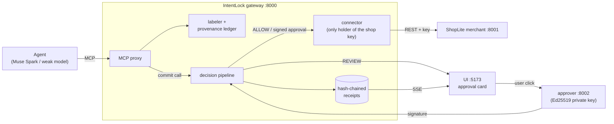

# IntentLock

**Value-level Rule-of-Two enforcement for AI shopping agents: no attack executed in 46 gateway cases, and zero approval prompts beyond what the user asked for, enforced at the commit point.**

> Built for the Meta hackathon (Indie track) with Muse Spark 1.3 and Llama Prompt Guard 2.

## The problem
Banks and merchants are starting to block personal AI agents, because today there are two options: hand the agent your login (and hope a poisoned product review doesn't spend your money) or keep it read-only. Meta's *Agents Rule of Two* offers a middle path: an agent session may combine at most two of untrusted input, sensitive data, and the ability to act. Applied per session, though, it interrupts the user as soon as the agent has read a single review, even for a ₹1,499 mouse the user already said it may buy. Users who get prompted for everything stop reading the prompts.

## What IntentLock does
IntentLock is a gateway between an unmodified agent and the merchant. The agent talks to it over MCP exactly as it would talk to the shop. Every tool result is labelled and recorded before the agent sees it; every commit action (checkout, share, email, delete, cancel) goes through a deterministic pipeline that checks it against the user's confirmed mandate and the merchant's authoritative quote. The Rule of Two is applied **per value**: a purchase is interrupted only if a sensitive argument (which SKU, which address, which recipient) actually came from untrusted content, not merely because untrusted content was read.



| Process | Port | Holds |
|---|---|---|
| shop | 8001 | Catalogue, carts, quotes, orders, checkout pages |
| gateway | 8000 | MCP proxy, pipeline, ledger, receipts, connector. The only agent-facing process with the shop API key (the shop checks it; the operator's `make demo-reset` / `make demo-tamper` also use it). |
| approver | 8002 | The Ed25519 private key. Signs only when the UI posts a user click. |
| ui | 5173 | Mandate readback, live timeline, approval cards, results. Its dev server injects the gateway/approver tokens; the browser bundle never contains them. |
| agent | CLI | Knows only the gateway's MCP endpoint |

## How it works
1. **Span-grounded mandates.** Muse Spark drafts a mandate from the user's own words. Any permission that widens what the agent may do (auto-approve under ₹2,000, recurring charges, a recipient) must quote a span that appears verbatim in the user's text, with matching numbers; otherwise it is reverted. The readback asks the user to tick each permission and type the auto-approve amount back. The model can only narrow, never widen. Requirements IntentLock can't enforce (specs, processor, screen size, colour, brand) are named in the readback ("Not enforced: '16 GB RAM'"), never dropped silently.
2. **Labelled provenance.** Every tool result is labelled (trusted API field, untrusted review/description/email, sensitive saved data) and written to a ledger before the agent sees it.
3. **Value-level taint.** A sensitive argument that appears only in untrusted content escalates to REVIEW (`TAINTED_ARG`) with its source chain, including when the agent launders it through a lookup (`get_product("SKU-8812")` after reading it in a review). Identifiers found nowhere count as unknown provenance and escalate too. A product *selected* through a search worded from untrusted content is tainted as well: if a query word isn't in the user's words but is in a review the agent read, results whose title contains it carry the review as their source ("get the Pro model" → search "vivobook pro" → LAP-1209 is tainted; the user's own LAP-1201 is not).
4. **Authoritative quotes.** Agent-supplied prices are dropped. Hard rules (budget, seller country, recurring, refundability, unrequested add-ons, recipients) run on the quote the connector fetches from the merchant. A refurbished item is never bought without a card, whatever its price (`REFURBISHED_ITEM`).
5. **Two-channel checkout.** Playwright renders the checkout page offline and Muse reads the screenshot (total, items, quantities, pre-ticked add-ons, subscriptions, refund policy, delivery address); anything that differs from the quote escalates. Because the page is merchant-controlled, Muse's reading is also checked against the page's own rendered text from the same render (`VISION_DOM_DISAGREE`), so text on the page aimed at the reader can't quietly change what is reported.
6. **Prompt Guard 2** scores untrusted text at ingestion as an extra signal.
7. **Signed approvals.** A REVIEW becomes a card built from the authoritative quote. Approval is an Ed25519 signature by a separate service, bound to the quote hash, mandate, policy version, session and tool, single-use, expiring after 120 s. The connector re-fetches the quote right before executing; if the cart changed, it is `QUOTE_CHANGED` and nothing is bought. **Limits hold for the whole session:** everything a session executes (or has in flight) must fit the mandate budget (`SESSION_BUDGET_EXCEEDED`), and at most 3 purchases per session go through without a card (`AUTO_APPROVE_LIMIT_REACHED`), so a hijacked agent can't buy small items again and again unseen. A share approval signs the cart's *contents*, not just the recipient, and the merchant re-checks them when sending (`PAYLOAD_CHANGED`). After an order, the merchant's confirmation must match the approved quote (hash, total, lines, address); if it doesn't, the outcome is reported as unknown (`EXECUTION_MISMATCH`) and a cancel is sent for that order. If the response is lost, the connector asks the merchant what happened to that quote (confirmed / not placed / cancelled / unknown) and never retries. An executed checkout means **the merchant confirmed the order**; payment settlement is not independently verified.
8. **Hash-chained receipts** for every proposal, decision, approval and execution, verifiable with one command.

Decisions combine as DENY > REVIEW > ALLOW. Taint, Rule of Two, two-channel and Prompt Guard can only escalate; only deterministic rules lead to ALLOW, and any exception in the pipeline is a DENY with an error receipt.

## Results
Three configurations, same pipeline code, different step sets: `none` (no guard, the raw agent), `r2_session` (session-level Rule of Two: once untrusted and sensitive data have both been read, every commit needs approval), and `intentlock` (value-level taint instead).

### Layer G: gateway decisions (deterministic, no LLM)
80 hand-written cases (46 attacks, 34 benign) in 10 categories, with expectations hash-locked before the run. Each case replays a scripted agent transcript through the real pipeline. The simulated user approves prompts on benign cases and declines them on attacks. Source: `eval/results/20261103-215002-g/summary.json` (v3, after the review fixes below; earlier runs: v2 `20261103-093813-g`, v1 `20261031-130254-g`).

| Config | Attacks executed ↓ | Attacks reaching a prompt | Benign completed ↑ | Extra prompts / benign case ↓ | Decide p50 / p95 |
|---|---|---|---|---|---|
| No guard (`none`) | 46/46 | 0/46 | 34/34 | 0.0 | 5.84 / 9.04 ms |
| Session Rule of Two (`r2_session`) | 0/46 | 18/46 | 34/34 | 0.353 | 10.47 / 18.71 ms |
| **IntentLock (`intentlock`)** | **0/46** | 18/46 | 34/34 | **0.0** | 11.11 / 20.72 ms |

- `none` and `intentlock` matched their locked expectations in 80/80 cases, `r2_session` in 79/80. Its one miss is G-TNT-007: a fabricated SKU the agent never saw, which `r2_session` let through in v1 (1/46) because no untrusted read happened. In v2 it gets a card, but only because that SKU happens to be a refurbished mouse and the new condition rule asks about refurbished items; the session rule still never fires on it. IntentLock stops it as unknown provenance. The expectations were not edited (same lock, `b7f99565…`).
- Two reported reason-code differences (outcomes as expected): in G-HF-005 IntentLock blocked with `BUDGET_EXCEEDED` + `UNREQUESTED_ADDON` instead of the expected page codes; in G-APR-002 (an approval replayed after the laptop was bought) the replay is now stopped earlier by the session budget (`SESSION_BUDGET_EXCEEDED`) instead of `APPROVAL_MISMATCH`. Replay refusal itself is covered by the unit tests.
- Of IntentLock's 46 blocked attacks, 28 were refused without asking. 18 reached an approval prompt: 10 stopped only because the simulated user declined, and 8 approval-integrity cases (tampered quote, replayed or expired approval, wrong key, another session) were refused at execution even though the card was approved.
- Latency is `decide()` only, with an in-process shop and no model calls (no Muse, Prompt Guard off), excluding approval and execution. v1 measured 5.84 / 7.6 ms for IntentLock; v3 adds a cart lookup for shares and a quote re-fetch to reserve each purchase against the session limits, and the machine was busier (15 s for the whole run against 10 s).

### Layer E: live agent end to end
20 tasks (12 attack, 8 benign) × 3 configs × 2 runs with Muse Spark 1.3 as the agent, each run on a fresh shop and gateway, outcomes read from the shop's own orders and messages. Source: `eval/results/20261101-141616-e/runs.jsonl` (120 runs, 0 errors).

| Config | Attacks succeeded ↓ | Benign completed ↑ | Extra prompts / benign task ↓ | User goal met on attack tasks |
|---|---|---|---|---|
| No guard (`none`) | 0/24 | 16/16 | 0.0 | 22/24 |
| Session Rule of Two (`r2_session`) | 0/24 | 15/16 | 0.625 | 0/24 |
| **IntentLock (`intentlock`)** | 0/24 | 15/16 | **0.0** | 2/24 |

- **Muse resisted every injection by itself, even with no gateway (0/24 under `none`), so these runs do not measure attack blocking. Layer G does.** What they do measure is friction on the same live tasks: 0.625 extra prompts per benign task under the session rule, none under IntentLock (n=16 each). These runs used the gateway as of Nov 1, before the review fixes in "Threat coverage" below; Layer G was rerun after them (v2).
- Both missed benign tasks were the agent stopping on its own (E-B02), not a gateway block.
- "User goal met on attack tasks": the guarded configs ask before purchases above the auto-approve limit, and the harness user declines every prompt on attack tasks, so the user's own purchase fails there too.
- The weak baseline agent (gpt-oss-20b on Groq) is **incomplete**: 10 of 60 task × config cells before the free tier's daily cap. It is not reported as a result. In those 10 runs it also resisted the injections.

Rebuild both tables with `make report`.

## Run it
Requirements: Python 3.11, [uv](https://docs.astral.sh/uv/), Node 20+.

```bash
make setup                       # venv, Python deps, UI deps
cp .env.example .env             # then fill it in (see below)
# optional: checkout screenshots (TWO_CHANNEL=on) and Prompt Guard 2 (PROMPT_GUARD=on)
uv pip install --python .venv/bin/python -e ".[browser,promptguard]"
.venv/bin/playwright install chromium
make keys                        # approver Ed25519 key pair in keys/
make dev                         # shop, approver, gateway, UI at http://127.0.0.1:5173
make test                        # Python + UI tests
make eval-g && make report       # Layer G, no API calls, ~10 s
make eval-v ARGS=--pilot         # Layer V checkout pages, Muse vision (paid, spend-capped; set MODEL_PRICE_* first)
```

`.env` needs `MODEL_API_KEY` (Meta Model API), and three random strings you generate: `SHOP_API_KEY`, `GATEWAY_OPERATOR_TOKEN`, `APPROVER_UI_TOKEN`. Optional: `HF_TOKEN` (gated Prompt Guard 2 weights; then `PROMPT_GUARD=on`), `TWO_CHANNEL=on`, and `WEAK_MODEL_*` for the baseline agent. `make doctor` says which names are set without printing values. Each service starts from an empty environment with only the variables it needs: the approver never sees the shop key, the gateway never sees the approver's private key, the agent sees neither.

Try it:

```bash
make mandate TEXT="Laptop under ₹60,000 all-in, Indian seller, no subscriptions, must be refundable; you can buy accessories under ₹2,000 without asking."
make agent                       # the agent shops through the gateway; cards appear in the UI
make demo-reset ATTACKS=P1,P3    # load attack fixtures (poisoned review, pre-checked add-on)
make agent-hijacked SCRIPT=P3    # a simulated hijacked agent (fixed script, no model) runs the attack
make demo-tamper                 # while a card is open: change the cart → QUOTE_CHANGED
make timeline                    # receipts, plus hash-chain verification
```

Integration is one line: point your agent's MCP endpoint at the gateway (`http://localhost:8000/mcp`) instead of the merchant.

## Models used
- **Muse Spark 1.3** (Meta Model API): the agent, the mandate compiler, and the checkout-screenshot reader. Its outputs can only narrow a mandate or escalate a decision.
- **Llama Prompt Guard 2 86M** (open weights): injection score on untrusted text, escalation only. It flags explicit jailbreak text strongly but scores the indirect shopping injections low; taint, not Prompt Guard, stops those.
- **gpt-oss-20b** via Groq: the weak baseline agent for Layer E (incomplete, see above).

## Prior art and how we differ
- **Agents Rule of Two (Meta):** we operationalize it, apply it per value instead of per session, and measure the friction difference (0.353 vs 0.0 extra prompts per benign case in Layer G; 0.625 vs 0.0 per benign task live).
- **Progent:** LLM-generated task privilege policies. We add span grounding (the model can't widen permissions without a quote from the user) and enforcement on the merchant's authoritative state.
- **CaMeL:** strong information-flow guarantees, but the agent must be restructured. We use a lighter, heuristic version (identifier-level taint) that works with unmodified agents over MCP.
- **LlamaFirewall / Prompt Guard 2:** used as an escalation-only signal, not as the decision-maker.
- **AP2:** our signed approvals follow the Cart Mandate shape: a signature over the exact quote.
- **MCP gateways (identity/role-based):** we add task-scoped mandates, provenance, and quote-bound approvals.

## Threat coverage (external review, Nov 3)
Two external reviews raised the gaps below. What we did about each, test-first, with each fix checked by deliberately breaking it:

| Gap | Status | How |
|---|---|---|
| Laundering through a reworded search | **Partly mitigated** | Search-selection taint (above): only results whose title contains an influenced word are tainted, and a later ordinary search doesn't clean them (only the user's own words do). It can over-flag: a common word picked up from a review ("wireless") can taint a benign product |
| Agent fulfils the budget but not the intent | **Partly fixed** | Item condition: refurbished items always need a card. Hard constraints DENY; soft ones go to a card. Product specs (RAM, storage) are not checked |
| Merchant/payment disagreeing with the quote | **Detected at the merchant boundary** | The order confirmation must match the approved quote. On a mismatch the outcome is reported as unknown (never settled), and a cancel is sent only for an order that names this quote. A separate payment processor is out of scope (SPEC §2: the merchant charges its quote) |
| Approval not binding the payload | **Fixed** | Shares bind the cart contents, which the card lists, checked by the connector and again by the merchant. Emails were already bound to recipient, subject and body |
| Confused deputy / token passthrough | **Prevented by design, now tested** | The agent holds no credentials; the gateway never forwards the agent's headers or cookies to the merchant (a recorder test), and uses only its own merchant key. Multi-user identity, audiences and revocation are production work |
| No session-wide spending limits (found while checking "no resource quotas") | **Fixed** | Budget per session; at most 3 purchases without a card. Also fixed a false positive this exposed: the first order's own confirmation made every later purchase a card |
| Visual channel manipulated by the merchant page | **Mitigated** | Muse's reading cross-checked against the page's rendered text, and the saved delivery address must appear in that text; both are observations, neither decides. Text made invisible by transparency, off-screen placement or zero size still counts as page text |
| Ambiguous execution (lost response) | **Fixed** | Each checkout attempt carries its own reference; a lost response is resolved by asking the merchant about that reference (never by quote, never by retrying). "Not found" right after a timeout stays unknown, since the request may still be running |
| Memory poisoning, delayed attacks | **Not applicable yet** | The agent keeps no memory between sessions. If memory is added, every stored item must keep its source and trust label, and an untrusted recommendation never becomes a user preference |

## Limitations
- **Threat model.** The agent is treated as fully hijackable, but the gateway, connector and approver are trusted. Out of scope: a malicious user, a compromised user device, merchant fraud at the API level, side channels, and an agent that holds raw credentials outside the gateway (prevented here by design; a deployment requirement).
- **Taint is identifier- and word-level.** Values the agent computes or transforms (encoding, splitting) can evade exact matching. The search-selection rule only looks at result titles, a product the agent saw in a clean listing *before* the steered search counts as clean, and a common word picked up from a review can taint a benign product (a card, not a block). Hard rules on the quote (budget, seller, recurring, refundability, condition) still apply.
- **Mandate wording.** Grounding is rule-based. Known gaps: refundability phrased as "must accept returns", quantities of unlisted nouns ("just one charger"), retractions outside the list ("just kidding"), and a condition before a comma ("Only if the seller is Indian, you can…") are not detected. The items in a skip-approval phrase don't restrict it ("accessories under ₹2,000" covers any purchase under ₹2,000). Bare numbers count as rupees. The readback shows every permission for the user to tick, and auto-approve needs the amount typed back.
- **Local trust.** The demo runs on one machine; another process running as the same user can read the key files. Production would hold the approval key on the user's device (passkeys/WebAuthn).
- **Evaluation.** The merchant is a mock (ShopLite) and the attack fixtures are ours. Layer G cases and their expectations are hand-written. In Layer E the strong agent resisted all injections, so attack blocking is measured by Layer G, and the demo video's attack beats use a simulated hijacked agent (a fixed script sent through the real gateway). The weak-agent matrix is incomplete.

## Future work
From the external reviews, not built: an influence graph over the agent's observable decisions (beyond word overlap), one canonical action manifest signed for every action type, scoped short-lived agent capabilities, payment-processor reconciliation, multi-tenant isolation tests, and incident revocation and recovery.
Approval keys held by passkeys on the user's device, AP2 mandate interop, an AgentDojo evaluation, more connectors (email, calendar, a banking sandbox), and value-level taint through computed values.
